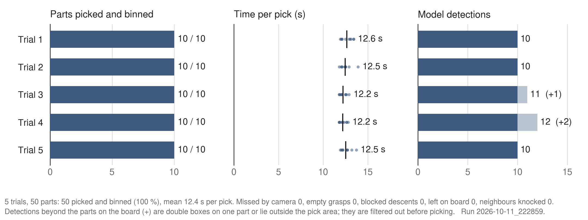
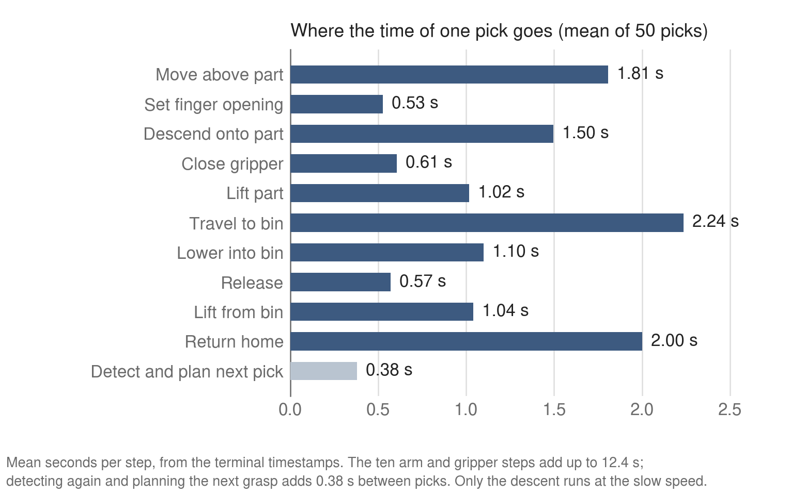

# carm-project

A UFACTORY xArm 6 that clears loose through-hole components off a circuit board and sorts
them into bins. A fixed Intel RealSense D435i looks at the board, a YOLO26 model running
locally finds the components, and MoveIt 2 moves the arm. After every pick the board is
looked at again, so each grasp is planned from a fresh image.

## Results

Five trials on 2026-10-11, ten loose capacitors on the board in each.

| | |
| --- | --- |
| Parts picked and binned | 50 of 50 |
| Retries, empty grasps, blocked descents, parts left on the board | 0 |
| Time per pick | 12.4 s mean (11.8 to 13.9 s) |
| Time to clear a board of ten | 125 to 130 s |
| Detections in the first image of each trial | 10, 10, 11, 12, 10 (three double boxes, one labelled transformer; all filtered out before picking) |





All 50 parts were capacitors, so these trials do not test sorting into different bins.

The full record is in [`results/five_trials_2026-10-11/`](results/five_trials_2026-10-11/README.md):
the raw logs, the terminal output, the snapshot images, derived tables and eleven plots.

The detector is `yolo26s_v9_1280`, a YOLO26s fine-tuned on our own photos plus a public
PCB dataset. On its test split (15 photos, 290 labelled objects) it scores:

| Class | Objects | Precision | Recall | mAP@50 | mAP@50-95 |
| --- | --- | --- | --- | --- | --- |
| All | 290 | 0.78 | 0.85 | 0.84 | 0.60 |
| Capacitor | 253 | 0.85 | 0.88 | 0.91 | 0.70 |
| Resistor | 8 | 0.76 | 0.88 | 0.81 | 0.49 |
| Transformer | 29 | 0.74 | 0.78 | 0.80 | 0.60 |

Its curves, confusion matrix and dataset breakdown are in
[`results/yolo26s_v9_1280/`](results/yolo26s_v9_1280/README.md); how it was trained is in
[`model_training/yolo26s_v9_1280.md`](model_training/yolo26s_v9_1280.md).

## How a pick works

Pressing `s` starts one trial, which runs until the board is empty:

1. **Detect.** The colour frame goes through the model. Detections under confidence 0.50
   are dropped, as are a second box within 8 mm of another and anything outside the pick
   area, which keeps the arm from picking parts back out of the bins.
2. **Locate.** Each detection is turned into a point in the robot's base frame using the
   aligned depth image and the camera-to-base transform. The grasp point is the centre of
   the part's top face, found in the depth points over the part.
3. **Choose.** The tallest part goes first: it is in the way of the fingers reaching for
   its neighbours and hides what stands behind it from the camera.
4. **Plan the grasp.** The fingers open to the part's width plus 6 mm per side, and the
   gripper turns to the angle where both fingers come down on free space. An angle that
   would put a neighbouring part between or under the fingers is refused, unless that
   neighbour ends below the fingertips. If every part left has a neighbour in the way,
   the tallest is taken anyway.
5. **Pick.** The arm moves above the part, descends straight down to 15 mm below its top
   (never below the table limit), closes, and lifts straight up. If the gripper closes on
   nothing, it opens again and skips the trip to the bin.
6. **Place.** The part is carried to the bin for its class and released, and the arm
   returns home, out of the camera's view.
7. **Repeat** from step 1 with a new image. A part that is still there is tried once
   more; a part pushed by the last pick is found where it now lies.

The descent in step 5 is guarded. If the shoulder or elbow motor current jumps by more
than 1.2 A within 0.2 s, the arm has come down on something: the move is cancelled, the
arm lifts off and the part is left for the next round. Only that descent runs slowly;
every move clear of the board runs at twice its speed.

## Repository layout

| Path | What it is |
| --- | --- |
| `main/main.py` | The pick-and-place loop, bin positions and grasp settings |
| `detection_model/yolo_model.py` | ROS 2 node: camera frames in, detections located in the robot's base frame out |
| `helpers/movement.py` | Arm and gripper moves through MoveIt, table limit, speeds, guarded descent |
| `helpers/part_top.py` | Finds the top face of a part in the depth points |
| `helpers/grasp_yaw.py` | Chooses the gripper angle and checks for neighbours |
| `helpers/run_log.py` | Writes the per-run log folder |
| `plot_trials.py` | KPI figure for one run |
| `test_main.py` | Self-checks that need no robot or camera |
| `calibration/` | Marker generator and detector for the hand-eye calibration |
| `model_training/` | Dataset preparation, training script and model card for the detector |
| `results/` | The trial record and the detector's evaluation |

## Setup

Tested on Ubuntu 22.04 with ROS 2 Humble and an RTX 5070.

ROS side, installed through apt or built in the ROS workspace:

- `realsense2_camera` (realsense-ros) and librealsense2
- `xarm_ros2`, for `xarm_moveit_config`
- MoveIt 2
- `easy_handeye2`, for publishing the camera-to-base transform
- `cv_bridge`, `image_geometry`, `tf2_ros`

Python side, in a venv at the repo root:

```bash
python3 -m venv .venv
# torch first, from the CUDA 12.8 index that the RTX 50-series needs:
.venv/bin/pip install torch torchvision --index-url https://download.pytorch.org/whl/cu128
.venv/bin/pip install -r requirements.txt
# ultralytics pulls in opencv-python, which overwrites opencv-contrib-python:
.venv/bin/pip uninstall -y opencv-python
.venv/bin/pip install --force-reinstall --no-deps 'opencv-contrib-python>=4.8,<4.12'
```

NumPy stays below 2 because the ROS Humble `cv_bridge` is built against NumPy 1.x.

The model weights are not in git. Put them at `detection_model/weights/yolo26s_v9_1280.pt`;
they are the `best.pt` of the training run described in `model_training/`.

## Running

Each step in its own terminal, with `/opt/ros/humble/setup.bash` and the ROS workspace
sourced.

**1) Camera.** The model and the grasp checks expect 1920x1080 colour with sharpness 100.
`publish_tf:=false` keeps the driver's own TF tree from colliding with the calibration
transform of step 2.

```bash
ros2 launch realsense2_camera rs_launch.py align_depth.enable:=true enable_sync:=true \
  enable_rgbd:=true publish_tf:=false rgb_camera.color_profile:=1920x1080x30
ros2 param set /camera/camera rgb_camera.sharpness 100
```

The sharpness setting is lost when the driver restarts, so set it after every start.

**2) Camera-to-base transform**, from the saved hand-eye calibration:

```bash
ros2 launch easy_handeye2 publish.launch.py name:=carm_eob
```

**3) MoveIt**, connected to the arm:

```bash
ros2 launch xarm_moveit_config xarm6_moveit_realmove.launch.py robot_ip:=192.168.1.225 add_gripper:=true
```

The same address is `XARM_IP` in `helpers/movement.py`, which reads the motor currents
for the guarded descent over the arm's own SDK. Without that connection the descents run
unguarded and a warning is printed.

**4) The pick loop**, with the repo venv active:

```bash
python3 main/main.py
```

The arm opens the gripper and moves home as soon as it starts. Then:

| Key | Does |
| --- | --- |
| `s` | Starts the next trial: clears the board, then asks the operator five count questions |
| `q` | Quits |

Trials are numbered on screen, with a running total of parts placed after each one. The
count starts at 1 each time `main.py` is started.

| Option | Does |
| --- | --- |
| `--target-class capacitor` | Picks only that class |
| `--hover` | Per `s` press, holds the open gripper 10 mm above the first part instead of picking, to check the alignment by eye |
| `--no-hardware` | Runs one cycle with made-up detections and a mock arm; needs no camera or robot |

To watch what the model sees, add these displays in RViz 2 with the fixed frame
`link_base`:

- **Image** on `/yolo/detection_image`: the last frame with its detection boxes.
- **MarkerArray** on `/yolo/detection_boxes`: one box per detection, placed where the arm
  will reach for it. These are for viewing only; MoveIt does not treat them as obstacles.

## Logs

Every run of `main.py` writes a folder `logs/<date>_<time>/`:

| File | Contents |
| --- | --- |
| `picks.csv` | One row per pick: position, top height, grasp point, estimated width, finger opening, gripper angle, outcome, grip width after closing, largest current jump of the descent, seconds |
| `snapshots.csv` | One row per trial: detections, parts located, placed, each kind of failure, parts remaining, and the operator's answers |
| `snapshot_NN_raw.jpg`, `_detections.jpg`, `_after.jpg` | The camera frame at the start of the trial, the same with boxes, and the last detection of the trial |

Outcomes in `picks.csv` are `placed`, `empty_grasp`, `blocked_descent`, `no_free_yaw`
(no gripper angle was free) and `move_failed`. `crowded` is 1 for a part taken although
a neighbour stood in the way.

`python3 plot_trials.py` draws the KPI figure for the newest run into its log folder;
`--run <folder name>` picks another.

## Settings

Bins, in `main/main.py` as `(x, y, release height)` in mm in the robot's base frame:

| Class | Bin |
| --- | --- |
| capacitor | (70, 220.6, 60) |
| resistor | (170, 220.6, 60) |
| transformer | (270, 220.6, 60) |
| any other class | (370, 220.6, 60) |

Grasping, in `main/main.py`:

| Constant | Value | Meaning |
| --- | --- | --- |
| `offset_x`, `offset_y` (in `main()`) | -14, 10 mm | Trim between where the camera sees a part and where the arm has to go; see the hover check below |
| `PICK_AREA_MM` | x 150 to 600, y -250 to 150 | Detections outside this are ignored |
| `GRASP_DEPTH_MM` | 15 | Fingertips stop this far below the part's top |
| `APPROACH_HEIGHT` | 80 mm | Height above the grasp from which the arm descends and to which it lifts |
| `FINGER_CLEARANCE_MM` | 6 | Free space per side added to the part's width for the finger opening |
| `GRIPPER_OPEN` | 400 (40 mm) | Largest opening, also used to release |
| `BOX_TO_PART_WIDTH` | 0.75 | Share of the detection-box width taken as a neighbour's real width |
| `EMPTY_GRIP_MM` | 1.0 | A gripper closed further than this holds nothing |
| `MAX_ATTEMPTS_PER_PART` | 2 | Tries per spot before a part is left |

Arm, in `helpers/movement.py`:

| Constant | Value | Meaning |
| --- | --- | --- |
| `MIN_Z_MM` | 6 mm | Lowest height the fingertips may be sent to: the measured table contact (-4 mm) plus 10 mm. A move below it is refused |
| `DEFAULT_SPEED` | 0.3 | Speed of the descent onto a part, as a fraction of MoveIt's planned speed |
| `TRAVEL_SPEED` | 0.6 | Speed of every other move |
| `BLOCKED_CURRENT_A` | 1.2 A | Current jump that stops a descent |
| `HOME_POSE_MM` | (130, 0, 300) | Rest pose between picks, clear of the camera's view |

Detection, in `detection_model/yolo_model.py`:

| Constant | Value | Meaning |
| --- | --- | --- |
| `MODEL_PATH` | `weights/yolo26s_v9_1280.pt` | Weights file |
| `MODEL_IMGSZ` | 1280 | Inference size; the 1920x1080 frame is scaled down to it |
| `CONF_THRESHOLD` | 0.50 | Lowest confidence acted on |
| `DUPLICATE_RADIUS_MM` | 8 | Detections closer together than this count as one part |
| `DEPTH_HALF_WINDOW` | 2 px | Half-width of the depth window sampled at a detection's centre |
| `DEPTH_RANGE_M` | 0.15 to 1.5 | Depth readings outside this are discarded |

Re-measure the table contact whenever the table, the mount or the fingers change: jog the
gripper down until it touches and read the height with

```bash
ros2 run tf2_ros tf2_echo link_base link_tcp
```

## Tests

```bash
python3 test_main.py
```

Checks the pick order, pick area, grasp planning, neighbour rule, top-face finder, empty
and blocked grasps, the current guard and the run log. It needs ROS sourced and the repo
venv, but no camera or robot.

## Camera calibration

The camera sits on a fixed mount beside the arm, so this is an eye-on-base calibration:
an ArUco marker is fixed to the gripper, the arm shows it to the camera from many poses,
and `easy_handeye2` solves for the transform from `link_base` to
`camera_color_optical_frame`. `calibration/aruco_realsense_tf_node.py` does the marker
detection.

Redo it whenever the camera or its mount is moved.

### One-time setup

`easy_handeye2` is built in the ROS workspace:

```bash
cd ~/carm_ws/src && git clone https://github.com/marcoesposito1988/easy_handeye2
cd ~/carm_ws && colcon build --packages-select easy_handeye2_msgs easy_handeye2
/usr/bin/python3 -m pip install --user -U 'transforms3d>=0.4'
```

Run every calibration command with the system Python, not the repo venv.

### Marker

One ArUco marker, `DICT_6X6_1000` id 398, mounted rigidly and flat on the gripper.
`calibration/generate_aruco.py` makes the printable image. The marker size is the side of
the black square alone, in metres.

### Procedure

Each step in its own terminal.

**1) Camera driver,** as in step 1 of Running.

**2) MoveIt,** as in step 3 of Running. Do not start the transform of step 2: the
calibrator publishes its own placeholder for the same link.

**3) Marker detector:**

```bash
python3 calibration/aruco_realsense_tf_node.py --ros-args \
  -p marker_id:=398 \
  -p marker_size:=0.115 \
  -p aruco_dictionary:=DICT_6X6_1000 \
  -p camera_frame:=camera_color_optical_frame \
  -p single_marker_frame_id:=aruco_marker \
  -p show_debug_window:=true
```

Check that it sees the marker:

```bash
ros2 run tf2_ros tf2_echo camera_color_optical_frame aruco_marker
```

**4) Calibrator:**

```bash
ros2 launch easy_handeye2 calibrate.launch.py \
  calibration_type:=eye_on_base \
  name:=carm_eob \
  robot_base_frame:=link_base \
  robot_effector_frame:=link_eef \
  tracking_base_frame:=camera_color_optical_frame \
  tracking_marker_frame:=aruco_marker
```

**5) Sample.** Move the arm to a pose where the camera sees the marker and press *Take
sample*. Do this for at least 15 poses, with large changes in orientation between them,
the marker close to the camera, and the poses spread over the whole image.

**6) Compute and save.** *Compute*, then *Save*, which writes
`~/.ros2/easy_handeye2/calibrations/carm_eob.calib`.

### Hover check

The calibration leaves an error of several millimetres, which `offset_x` and `offset_y`
in `main/main.py` take out. To measure it, stand one capacitor alone on the board and run

```bash
python3 main/main.py --hover
```

Press `s`. The open gripper stops 10 mm above the part and waits. Look along the fingers
and across them, or photograph both views level with the fingertips, and note how far the
part's centre is from the middle of the gripper and in which direction. Adjust the two
offsets by that amount and repeat at several spots on the board. With the offsets above,
the part is within 2 to 3 mm of the centre at the middle and at two opposite corners of
the board.
